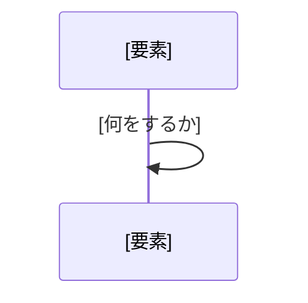

# 現状調査の型

## 文書構成

次の順で出す。空なら `なし`。

```markdown
# 調査目的

## 概要

## 業務ルール

### [ルール]

## ユースケース一覧

### [利用環境]

## ユースケース詳細

### [ユースケース名]

## 画面一覧

## 画面遷移図

### [利用環境]

## API一覧

## システム構成図

### [テーマ]

## 抽象ER図

### [テーマ]

## システム詳細

### [テーマ]

## 未確認事項
```

## 各節の型

### 調査目的

何の現状調査かを示す。

```markdown
# 調査目的

[調査の目的]

- 対象:
  - [対象]
- 入口:
  - [入口]: [根拠のパス]
- リポジトリ:
  - [リポジトリ]（[ブランチ]）
```

- `[調査の目的]` は、ユーザーがヒアリングで答えた、調べる理由を 1 文で書く。答えが無ければ「[対象] の現行の構成と処理の流れを調べる。」と書く
- `[対象]` は、ユーザーがヒアリングで答えた画面名か機能名
- `[入口]` は、調べて特定した URL、API、コマンド、ジョブなど。複数あれば全て並べる
- `[根拠のパス]` は、`### パスの書き方` で書く
- `[リポジトリ]` と `[ブランチ]` は、根拠に使ったリポジトリと、読んだときの `.git/HEAD` のブランチ。複数あれば全て並べる

### 概要

今どう動いているかを、最初に掴ませる。

```markdown
## 概要

[今どう動いているか]
```

### 業務ルール

コードが強制している業務上の決まりと、その目的を示す。

```markdown
## 業務ルール

### [ルール]

- 目的:
  - [目的]
- 根拠:
  - [根拠のパス]
```

- `[目的]` は、コードやコメント、資料から読み取れるものだけ書く。読み取れなければ「読み取れない」と書き、未確認事項に入れる
- 仕様かどうか疑わしいものは、`[目的]` にその疑いを書く

### ユースケース一覧

利用環境ごとに、誰が何をするかを示す。

````markdown
## ユースケース一覧

### [利用環境]

```mermaid
flowchart LR
  [ID]["[利用環境]"] -->|"[経路]"| [ID]["[ユースケース名]"]
```
````

- `[利用環境]` は、対象を使う環境（例: PC、スマートフォン、アプリ）。できることが同じ利用環境は、1 つの見出しにまとめる
- 図 1 枚に描くユースケースは 5 個までにする。超えたら、同じ見出しの下に図を分けて続ける
- ユースケースは、利用者の目的の単位にまとめる

### ユースケース詳細

ユースケースごとに、処理が動く順を示す。

````markdown
## ユースケース詳細

### [ユースケース名]


````

- `[ユースケース名]` は、ユースケース一覧のユースケースを 1 つずつ見出しにする。利用環境が違っても、同じユースケースの見出しは 1 つにする
- シーケンス図は、利用者の操作から応答までを、利用者、画面などの入口、API の粒度で描く。そのユースケースに含まれる操作、入口、利用環境の違いは、`alt` で全て描く

### 画面一覧

対象の画面を示す。

```markdown
## 画面一覧

| 画面 | URL | 利用環境 | 実装 |
| --- | --- | --- | --- |
| [画面] | [URL] | [利用環境] | [根拠のパス] |
```

- 利用環境でテンプレートが分かれていれば、行を分ける

### 画面遷移図

対象の画面に入ってくる遷移と、出ていく遷移を示す。

````markdown
## 画面遷移図

### [利用環境]

```mermaid
flowchart LR
  [ID]["[画面]"] -->|"[操作]"| [ID]["[画面]"]
  classDef target fill:#dbeafe,stroke:#2563eb
  class [対象の画面の ID] target
```
````

- `[利用環境]` は、ユースケース一覧と同じ。遷移が同じ利用環境は、1 つの見出しにまとめる
- 対象外の画面も、遷移の元と先として描く

### API一覧

対象の画面やアプリが、対象の機能のために呼ぶ API を示す。

```markdown
## API一覧

| メソッド | パス | 呼ぶ側 | 処理 | 実装 |
| --- | --- | --- | --- | --- |
| [メソッド] | [パス] | [画面、JS、アプリ] | [何をするか] | [根拠のパス] |
```

### システム構成図

対象の全体像を抽象化して示し、入口や特筆すべきことごとに、処理の流れをシーケンス図で詳しく示す。

````markdown
## システム構成図

```mermaid
flowchart LR
  [ID]["[要素]"] -->|"[何を渡すか]"| [ID]["[要素]"]
```

### [テーマ]


````

- `[テーマ]` は、入口か特筆すべきこと
- シーケンス図は、仕組みの中の要素どうしのやり取りを描く

### 抽象ER図

対象が読み書きするテーブルと、そのつながりを示す。

````markdown
## 抽象ER図

### [テーマ]

```mermaid
erDiagram
  [テーブル] ||--o{ [テーブル] : "[関係]"
  [テーブル] {
    [型] [列] PK
    [型] [列] FK
  }
```
````

- `[テーマ]` は、つながりの強いテーブルのまとまり。テーマをまたぐテーブルは、両方の図に描く
- テーブルは、対象が読み書きするものだけ描く
- 列は、主キーと外部キーだけ描く
- 外部キー制約が無く、コードの結合条件から読み取った関係も描く。どちらかはシステム詳細に書く

### システム詳細

図に表せない現行の事実と、その根拠を示す。

```markdown
## システム詳細

### [テーマ]

[現行の事実]

関連コード:

- [根拠のパス]
```

- `[テーマ]` は、その節で分かることを 1 文で書く。名詞だけのラベルにしない
- 画面一覧、画面遷移図、API一覧に載せたものは、一覧として並べ直さない
- `[現行の事実]` には、根拠のリンクを入れない
- `[根拠のパス]` は、`### パスの書き方` で書く

### 未確認事項

調べても確かめられなかったことを示す。

```markdown
## 未確認事項

- [確かめること]:
  - [確かめる相手か方法]
```

## 記述パターン

### パスの書き方

パスを書くときに使う。

```markdown
[{相対パス}:{開始行}-{終了行}]({blob リンク}#L{開始行}-{終了行})
```

- `{相対パス}` は、リポジトリのルートからの相対パス
- `{blob リンク}` は、そのリポジトリの `.git/config` の remote URL と `.git/HEAD` のブランチから作る GitHub / GitLab の blob リンク。作れなければリンクを付けず、`{相対パス}:{開始行}-{終了行}` だけ書く。GitHub の行番号は `#L{開始行}-L{終了行}`
- ファイル全体を指すときは、行番号を付けない
- 資料のページを指すときは、`[{ページ名}]({ページの URL})` と書く

### Mermaid の書き方

Mermaid の図を書くときに使う。

````markdown
```mermaid
flowchart LR
  [ID]["[表示名]"] -->|"[線のラベル]"| [ID]["[表示名]"]
```


````

- `[ID]` は、英数字とアンダースコアだけで書く
- flowchart の `[表示名]` と `[線のラベル]` は、ダブルクォートで囲む。記号や括弧があると構文エラーになるため
- sequenceDiagram の `[表示名]` と `[何をするか]` は、ダブルクォートで囲まない。囲むとそのまま表示される
